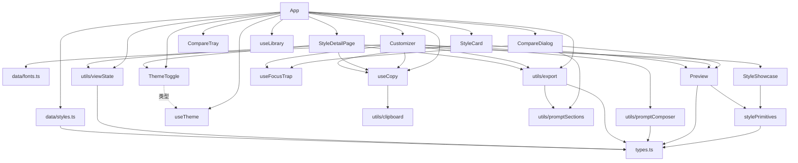

# 05 · 依赖关系

> 本项目的依赖策略是「能用编译期解决的不用运行时解决」。运行时依赖只有 2 个包；真正需要警惕的不是 npm 依赖，而是**跨文件的隐性耦合常量**（§5）。

---

## 1. 外部依赖

### 1.1 运行时依赖（`dependencies`）

| 包 | 版本 | 用途 | 不可替代性 |
| --- | --- | --- | --- |
| `react` | ^19.3.1 | UI 运行时 | 是 |
| `react-dom` | ^19.3.1 | DOM 渲染 | 是 |

**没有第三个。** 没有路由（`react-router`）、没有状态库（`zustand`/`redux`）、没有组件库（`shadcn`/`antd`）、没有图标库（图标用 Unicode 字符 `★ ☆ ✕ ◷`）、没有 Markdown 渲染器（正文用 60 行自研解析）、没有日期库（`dateStamp` 手写）。

### 1.2 开发依赖（`devDependencies`）

| 包 | 版本 | 用途 | 备注 |
| --- | --- | --- | --- |
| `vite` | ^8.3.7 | 开发服务器与打包 | 8.x 起基于 Rolldown；`engines: ^20.19 \|\| >=22.12` |
| `@vitejs/plugin-react` | ^6.3.0 | JSX 转换 + Fast Refresh | — |
| `tailwindcss` | ^4.3.5 | 工具类生成 | v4 **CSS-first**：无 `tailwind.config.js`、无 `postcss.config.js` |
| `@tailwindcss/vite` | ^4.3.5 | Tailwind 的 Vite 插件 | 内建 Lightning CSS 与前缀处理，故不需要 PostCSS / autoprefixer |
| `typescript` | ~6.0.3 | 类型检查 | `build` 脚本先跑 `tsc -b` |
| `@types/react` / `@types/react-dom` | ^19.3.0 | 类型声明 | — |
| `@types/node` | ^26.6.6 | 让 `vite.config.ts` 能用 `node:url`（`fileURLToPath`） | **只在 `tsconfig.node.json` 可见**（该文件写了 `"types": ["node"]`）。`tsconfig.app.json` 不写 `types`，所以 `src/` 里用 `process` / `Buffer` 仍报 TS2591，浏览器代码不会被 Node 全局污染；产物零影响（纯类型，不进 bundle） |
| `esbuild` | ^0.28.2 | 供 `verify-styles.mjs` 把 TS 数据打包成可 import 的 ESM | **显式声明的原因**：Vite 8 换 Rolldown 后不再传递提供 esbuild，不显式声明会让 `verify:data` 报「找不到模块」 |

### 1.3 验证脚本的运行时依赖

| 工具 | 来源 | 说明 |
| --- | --- | --- |
| `playwright-core` | `devDependencies` 显式声明（^1.65.0），`verify-ui.cjs` 的 `loadPlaywrightCore` 常规解析 | 托管工作区路径与全局 `playwright` 仅作历史兜底，不是必需项 |
| 浏览器 | `launchBrowser` 逐级尝试：`SG_CHROME_PATH` / `CHROME_PATH` → Playwright 自带 Chromium → 系统 Chrome / Edge → `channel` → 默认解析 | 不写死 revision 号，也不扫描缓存里的历史版本：旧内核缺少 `checkVisibility` 等新 API，报错信息与真实原因无关 |

---

## 2. 内部依赖矩阵

行 = 依赖方，列 = 被依赖方。`▲` 表示仅类型导入（`import type`，编译后消失）。

列名缩写：`prim` = `stylePrimitives` · `Pv` = `Preview` · `Sc` = `StyleShowcase` · `Card` = `StyleCard` · `Detail` = `StyleDetailPage` · `Cstm` = `Customizer` · `Cmp*` = `CompareTray` + `CompareDialog` · `copy` = `useCopy` · `trap` = `useFocusTrap` · `lib` = `useLibrary` · `clip` = `clipboard` · `url` = `viewState` · `sect` = `promptSections` · `exp` = `export` · `comp` = `promptComposer` · `TT` = `ThemeToggle` · `theme` = `useTheme` · `css` = `index.css`。

| 模块 | types | styles | fonts | prim | Pv | Sc | Card | Detail | Cstm | Cmp* | copy | trap | lib | clip | url | sect | exp | comp | TT | theme | css |
| --- | :-: | :-: | :-: | :-: | :-: | :-: | :-: | :-: | :-: | :-: | :-: | :-: | :-: | :-: | :-: | :-: | :-: | :-: | :-: | :-: | :-: |
| `main.tsx` |  |  |  |  |  |  |  |  |  |  |  |  |  |  |  |  |  |  |  |  | ✓ |
| `App.tsx` | ▲ | ✓ |  |  |  |  | ✓ | ✓ | ✓ | ✓ | ✓ |  | ✓ |  | ✓ |  | ✓ |  | ✓ | ✓ |  |
| `StyleCard` | ▲ |  |  |  | ✓ |  |  |  |  |  | ✓ |  |  |  |  |  |  |  |  |  |  |
| `Preview` | ▲ |  |  | ✓ |  |  |  |  |  |  |  |  |  |  |  |  |  |  |  |  |  |
| `StyleShowcase` | ▲ |  |  | ✓ |  |  |  |  |  |  |  |  |  |  |  |  |  |  |  |  |  |
| `stylePrimitives` | ▲ |  |  |  |  |  |  |  |  |  |  |  |  |  |  |  |  |  |  |  |  |
| `StyleDetailPage` | ▲ |  |  |  |  | ✓ |  |  |  |  | ✓ |  |  |  | ✓ |  | ✓ |  | ✓ | ▲ |  |
| `Customizer` | ▲ |  | ✓ |  | ✓ |  |  |  |  |  | ✓ | ✓ |  |  |  |  | ✓ | ✓ |  |  |  |
| `CompareTray` | ▲ |  |  |  |  |  |  |  |  |  |  |  |  |  |  |  |  |  |  |  |  |
| `CompareDialog` | ▲ |  |  |  | ✓ |  |  |  |  |  |  | ✓ |  |  |  | ✓ |  |  |  |  |  |
| `ThemeToggle` |  |  |  |  |  |  |  |  |  |  |  |  |  |  |  |  |  |  |  | ▲ |  |
| `useCopy` |  |  |  |  |  |  |  |  |  |  |  |  |  | ✓ |  |  |  |  |  |  |  |
| `useFocusTrap` |  |  |  |  |  |  |  |  |  |  |  |  |  |  |  |  |  |  |  |  |  |
| `useLibrary` |  |  |  |  |  |  |  |  |  |  |  |  |  |  |  |  |  |  |  |  |  |
| `useTheme` |  |  |  |  |  |  |  |  |  |  |  |  |  |  |  |  |  |  |  |  |  |
| `clipboard` |  |  |  |  |  |  |  |  |  |  |  |  |  |  |  |  |  |  |  |  |  |
| `viewState` | ▲ |  |  |  |  |  |  |  |  |  |  |  |  |  |  |  |  |  |  |  |  |
| `promptSections` |  |  |  |  |  |  |  |  |  |  |  |  |  |  |  |  |  |  |  |  |  |
| `export` | ▲ |  |  |  |  |  |  |  |  |  |  |  |  |  |  | ✓ |  |  |  |  |  |
| `promptComposer` | ▲ |  |  | ✓ |  |  |  |  |  |  |  |  |  |  |  |  |  |  |  |  |  |
| `data/styles` | ▲ |  |  |  |  |  |  |  |  |  |  |  |  |  |  |  |  |  |  |  |  |
| `data/fonts` |  |  |  |  |  |  |  |  |  |  |  |  |  |  |  |  |  |  |  |  |  |

`Cmp*` 一列合并 `CompareTray` 与 `CompareDialog`。**矩阵中不含任何自反项，也不存在环**（按层级单向，L1 从不 import L2 以上）。

唯一例外：`utils/promptComposer → components/stylePrimitives`（表内 `✓`，运行时）。它查的是 `usesConfigRadius()`——「哪些变体的圆角自锁、不认 `cfg.radius`」。这条知识必须与 `stylePrimitives` 的变体 switch 同文件，否则两处会漂；因此宁可让 utils 反向依赖一个纯样式模块（`stylePrimitives` 自身只依赖 `types`，无状态无副作用），也不把集合复制到 utils。往 `stylePrimitives` 加新变体时同步 §5 的 `RADIUS_PINNED_*`。

（Mermaid 仅为阅读辅助，实际渲染以编辑器支持为准；上表才是权威。）

---

## 3. 依赖方向规则

1. **数据 → 类型 → 纯工具 → hook → 组件 → 容器**，单向。任何反向 import 都是设计错误。
2. `stylePrimitives` 只依赖 `types`，是整个组件层的最底层；`Preview` 与 `StyleShowcase` 都只多依赖它一个模块。
3. `utils` 层之间只允许 `export → promptSections`（且方向合理：导出复用了切分）。新增 utils 之间的依赖需评审。
   `promptComposer → stylePrimitives` 是唯一一条 utils 指向组件层的 import，理由见 §3 表下注（圆角自锁知识与变体 switch 必须同文件）。
4. 组件之间默认**没有横向依赖**（`StyleDetailPage` 不 import `Customizer`，只通过 `onCustomize` 回调交给 App）。既有组合只有 `StyleDetailPage → StyleShowcase` 与两处视图复用 `ThemeToggle`；后者仅接收 props，不持有主题状态。
5. `App` 不被任何模块 import（含测试）—— 它只作为 `main.tsx` 的渲染根。

---

## 4. 外部服务依赖

| 服务 | 用途 | 失败后果 | 缓解 |
| --- | --- | --- | --- |
| Google Fonts（`fonts.googleapis.com`） | 27 个字体族 | 预览与外壳回落到系统字体，样张辨识度下降，功能不受影响 | `display=swap`；`preconnect`；字体栈均带 `sans-serif`/`serif` 兜底 |

无 analytics、无错误上报、无 CDN 脚本、无第三方 API。**页面运行时只有 2 个外部请求**（`index.html` 里那一行 Fonts CSS 会再引字体文件）。

---

## 5. 隐性耦合常量（改动前必查）

这是本项目最容易出错的部分：以下常量在多个文件里**各自独立存在**，类型系统管不到，只能靠纪律与脚本。

| 常量 / 契约 | 定义处 | 必须同步的位置 | 漏改后果 |
| --- | --- | --- | --- |
| 风格总数 `35` | `scripts/verify-ui.cjs` 的 `TOTAL_STYLES` | 数据新增后手动改 | `F2b 合集导出` 断言失败 |
| `StyleCategory` 9 个字面量 | `src/types.ts` | `CATEGORIES`（data/styles）、`CATEGORY_SLUGS`（viewState） | 新分类无法筛选 / 无法进 URL |
| 提示词 7 段标题 | 每条 `prompt` | `verify-styles.mjs` 的 `SECTIONS`；`export.ts` 的 `designSectionBody` 入参；`promptComposer.isSectionDisabled` 的关键字 | 校验失败，或 DESIGN.md 章节静默变空 |
| `ButtonVariant` 10 项 | `src/types.ts` | `verify-styles.mjs` 的 `BUTTON_VARIANTS`；`stylePrimitives.stylePrimaryButton` / `styleSecondaryButton` 的 switch | 校验失败 / 落到 `default` |
| `CardVariant` 11 项 | `src/types.ts` | `verify-styles.mjs` 的 `CARD_VARIANTS`；`stylePrimitives.stylePanel` 的 switch | 同上 |
| 圆角自锁变体集合 `RADIUS_PINNED_CARD_VARIANTS` / `RADIUS_PINNED_BUTTON_VARIANTS` | `stylePrimitives.ts` | 同文件的 `stylePrimaryButton` / `styleSecondaryButton` / `stylePanel` 三个 switch（变体改为硬编码圆角或改回用 `cfg.radius` 时必须同步）；`promptComposer.derivePreview` 经 `usesConfigRadius()` 消费 | 定制器把提示词写成「圆角 29px」，而预览里那款风格根本不用这个值 —— 破坏「所见即所交付」 |
| 字体清单 27 项 | `index.html` 的 `<link>` | `data/fonts.ts` 的 `FONT_OPTIONS`；每条 `preview.headingFont/bodyFont` | 定制下拉里选了却没加载 / 校验报「未引入」 |
| 分类 slug 表 | `viewState.ts` 的 `CATEGORY_SLUGS` | 与 `StyleCategory` 一一对应 | 深链打不开对应分类 |
| localStorage 键 | `useLibrary.ts` 两个常量、`useTheme.ts` 的 `THEME_STORAGE_KEY` | `index.html` 同步初始化脚本；`verify-ui.cjs` 的 F3 / T 系列断言字面量 | 断言失败 / 历史数据或主题偏好「看起来丢了」 / light 首屏闪 dark |
| URL 参数名 `cat` / `q` / `style` | `viewState.ts` | `verify-ui.cjs` 的 F1 系列断言、`buildShareLink`（页脚已于 2026-11-17 删除，不再展示参数示例） | 深链失效 |
| 段落开关顺序 | `Customizer.tsx` 的 `SECTION_META` | `verify-ui.cjs` 的 `input[type=checkbox].nth(2)` | 断言点错开关 |
| `COMPARE_LIMIT = 3` | `App.tsx` | 提示文案（同文件内插值，安全）、对比视图网格（自适应列数，安全） | 仅文案 |
| 展示区 6 段顺序 | `StyleShowcase.tsx` 的 6 个顶层块 | `verify-ui.cjs` 的 `F1a`（`showcaseBlocks === 6`）、D2 的结构签名 | 断言失败（说明结构与约定脱节） |
| 详情页锚点 `data-style-detail` / `data-style-id` / `data-showcase-frame` / `data-showcase` / `data-showcase-style` | `StyleDetailPage` / `StyleShowcase` | `verify-ui.cjs` 的 F1a / S1 / D1 / D2 / F9a（`data-showcase-style` 是 S1a「样张与详情页同源」的唯一证据，替代了原先检查页面文案的做法） | 断言整体失灵（比绑类名更隐蔽，因为改锚点时脚本不报错，只是查不到） |
| 卡片封面锚点 `data-cover-id` | `StyleCard` | `App` 的焦点归还查询、`verify-ui.cjs` 的 S1c / D1 | 返回画廊后焦点丢失 / 断言失败 |
| 主题色 `#0b0b0e` / `#f9f8f6` | `useTheme.ts` 的 `THEME_COLORS` | `index.html` 同步脚本、T1a/T1b 断言 | 浏览器 chrome 与页面主题不一致 |
| 主题入口锚点 `data-theme-toggle` / `data-theme` | `ThemeToggle` | `verify-ui.cjs` 的 T 系列 | 主题断言无法定位入口或误判当前模式 |
| `@` → `src` 别名 | `vite.config.ts` 的 `resolve.alias` | `tsconfig.app.json` 的 `paths`（两处都是死映射，无脚本校验） | 只改一处：要么编辑器与 `tsc -b` 报 TS2307，要么类型通过但打包失败 |

---

## 6. 变更影响分析

| 你改了 | 直接影响 | 需要同步 | 回归重点 |
| --- | --- | --- | --- |
| `src/index.css` 的 `@theme` / `html.light` | 全站外壳 | `verify-ui.cjs` 的 T 系列 | dark 原值不变；light 三级文字 ≥4.5:1；按钮使用 `on-ink/on-brand`；圆角仍统一 2px；样张不变色 |
| `stylePrimitives.ts` 任一变体函数 | 35 张卡片封面 + 定制预览 + 对比视图 + 35 个详情页样张 | 无 | 抽查 4 类底色（浅 / 深 / 半透明 / 霓虹）下的封面与详情页样张 |
| `StyleShowcase.tsx` 的段落结构 | 35 个详情页的展示框 | `verify-ui.cjs` 的 `showcaseBlocks === 6` | 详情页样张高度与骨架是否仍然统一 |
| `StyleDetailPage.tsx` 的顶栏高度 | 侧栏 `lg:top-20` 的吸顶偏移 | 无 | 侧栏是否贴到顶栏下方 |
| `types.ts` 增删字段 | 全项目类型错误（这是好事，编译器会指路） | 数据、校验脚本、导出模板 | `tsc -b` |
| `data/styles.ts` 加条目 | 卡片、筛选、导出、术语统计 | `TOTAL_STYLES`（verify-ui） | `verify:data` + `verify:ui` |
| `export.ts` 的输出格式 | 用户下载的文件 | `verify-ui.cjs` 的 F2 / F9 断言（按章节标题匹配） | 下载文件结构 |
| `useLibrary.ts` 的键名 | 用户已有收藏 | 断言中的字面量、升级迁移（当前无迁移逻辑） | 老用户数据是否「消失」 |
| `useTheme.ts` 的键名 / 主题色 | 用户已有外观偏好与首屏初始化 | `index.html` 同步脚本、T 系列断言 | light 首屏是否闪 dark；非法值是否回退 dark |
| `viewState.ts` 参数名 | 已分享的链接 | 断言 | 旧参数是否仍可读 |
| 组件 props | 调用方（多为 App） | 类型会自动报错 | `tsc -b` |

---

## 7. 依赖健康度小结

**优点**

- 依赖极少，`npm audit` 面积极小；无深层传递依赖（除 Vite 自身）。
- 无环、无全局单例；组件复用仅限纯展示的 `ThemeToggle`，状态仍集中在 App。
- 类型覆盖到数据层，`strict` + `noUnusedLocals/Parameters` 让死代码与半成品改动无法通过构建。

**风险**

- 两个验证脚本依赖仓库外的工具（`playwright-core` 与本地 Chromium 路径），换机器可能跑不起来 —— 属「验证能力」而非「功能」缺失。
- 数据文件 2191 行，多人并行改内容时合并冲突概率高。
- 隐性耦合常量集中在 §5，其中「7 段标题」同时被三处消费，是最脆的一环。
