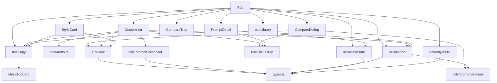

# 05 · 依赖关系

> 本项目的依赖策略是「能用编译期解决的不用运行时解决」。运行时依赖只有 2 个包；真正需要警惕的不是 npm 依赖，而是**跨文件的隐性耦合常量**（§5）。

---

## 1. 外部依赖

### 1.1 运行时依赖（`dependencies`）

| 包 | 版本 | 用途 | 不可替代性 |
| --- | --- | --- | --- |
| `react` | ^19.3.1 | UI 运行时 | 是 |
| `react-dom` | ^19.3.1 | DOM 渲染 | 是 |

**没有第三个。** 没有路由（`react-router`）、没有状态库（`zustand`/`redux`）、没有组件库（`shadcn`/`antd`）、没有图标库（图标用 Unicode 字符 `★ ☆ ✕ ◷`）、没有 Markdown 渲染器（正文用 60 行自研解析）、没有日期库（`dateStamp` 手写）。

### 1.2 开发依赖（`devDependencies`）

| 包 | 版本 | 用途 | 备注 |
| --- | --- | --- | --- |
| `vite` | ^8.3.7 | 开发服务器与打包 | 8.x 起基于 Rolldown；`engines: ^20.19 \|\| >=22.12` |
| `@vitejs/plugin-react` | ^6.3.0 | JSX 转换 + Fast Refresh | — |
| `tailwindcss` | ^4.3.5 | 工具类生成 | v4 **CSS-first**：无 `tailwind.config.js`、无 `postcss.config.js` |
| `@tailwindcss/vite` | ^4.3.5 | Tailwind 的 Vite 插件 | 内建 Lightning CSS 与前缀处理，故不需要 PostCSS / autoprefixer |
| `typescript` | ~6.0.3 | 类型检查 | `build` 脚本先跑 `tsc -b` |
| `@types/react` / `@types/react-dom` | ^19.3.0 | 类型声明 | — |
| `esbuild` | ^0.28.2 | 供 `verify-styles.mjs` 把 TS 数据打包成可 import 的 ESM | **显式声明的原因**：Vite 8 换 Rolldown 后不再传递提供 esbuild，不显式声明会让 `verify:data` 报「找不到模块」 |

### 1.3 未声明但被使用的依赖

| 工具 | 来源 | 影响 |
| --- | --- | --- |
| `playwright-core` | 从托管工作区 `~/.workbuddy/binaries/node/workspace/node_modules` 解析（`verify-ui.cjs` 的 `loadPlaywrightCore`） | 新机器上 `npm run verify:ui` 可能因找不到该包而失败；这是**已知的可移植性缺口**，不影响应用构建 |
| 本地 Chromium | `ms-playwright/chromium-1045` 或 `chromium-978106`（两个候选路径写死） | 播放器版本升级后路径变化会让脚本报「未找到本地 chromium」 |

---

## 2. 内部依赖矩阵

行 = 依赖方，列 = 被依赖方。`▲` 表示仅类型导入（`import type`，编译后消失）。

| 模块 | types | data/styles | data/fonts | Preview | StyleCard | PromptDetail | Customizer | Compare* | useCopy | useTrap | useLib | clipboard | viewState | promptSections | export | composer | index.css |
| --- | :-: | :-: | :-: | :-: | :-: | :-: | :-: | :-: | :-: | :-: | :-: | :-: | :-: | :-: | :-: | :-: | :-: |
| `main.tsx` |  |  |  |  |  |  |  |  |  |  |  |  |  |  |  |  | ✓ |
| `App.tsx` | ▲ | ✓ |  |  | ✓ | ✓ | ✓ | ✓ | ✓ |  | ✓ |  | ✓ |  | ✓ |  |  |
| `StyleCard` | ▲ |  |  | ✓ |  |  |  |  | ✓ |  |  |  |  |  |  |  |  |
| `Preview` | ▲ |  |  |  |  |  |  |  |  |  |  |  |  |  |  |  |  |
| `PromptDetail` | ▲ |  |  |  |  |  |  |  | ✓ | ✓ |  |  | ✓ |  | ✓ |  |  |
| `Customizer` | ▲ |  | ✓ | ✓ |  |  |  |  | ✓ | ✓ |  |  |  |  | ✓ | ✓ |  |
| `CompareTray` | ▲ |  |  |  |  |  |  |  |  |  |  |  |  |  |  |  |  |
| `CompareDialog` | ▲ |  |  | ✓ |  |  |  |  |  | ✓ |  |  |  | ✓ |  |  |  |
| `useCopy` |  |  |  |  |  |  |  |  |  |  |  | ✓ |  |  |  |  |  |
| `useFocusTrap` |  |  |  |  |  |  |  |  |  |  |  |  |  |  |  |  |  |
| `useLibrary` |  |  |  |  |  |  |  |  |  |  |  |  |  |  |  |  |  |
| `clipboard` |  |  |  |  |  |  |  |  |  |  |  |  |  |  |  |  |  |
| `viewState` | ▲ |  |  |  |  |  |  |  |  |  |  |  |  |  |  |  |  |
| `promptSections` |  |  |  |  |  |  |  |  |  |  |  |  |  |  |  |  |  |
| `export` | ▲ |  |  |  |  |  |  |  |  |  |  |  |  | ✓ |  |  |  |
| `promptComposer` | ▲ |  |  |  |  |  |  |  |  |  |  |  |  |  |  |  |  |
| `data/styles` | ▲ |  |  |  |  |  |  |  |  |  |  |  |  |  |  |  |  |
| `data/fonts` |  |  |  |  |  |  |  |  |  |  |  |  |  |  |  |  |  |

`Compare*` 一列合并 `CompareTray` 与 `CompareDialog`。**矩阵中不含任何自反项，也不存在环**（按层级单向，L1 从不 import L2 以上）。

（Mermaid 仅为阅读辅助，实际渲染以编辑器支持为准；上表才是权威。）

---

## 3. 依赖方向规则

1. **数据 → 类型 → 纯工具 → hook → 组件 → 容器**，单向。任何反向 import 都是设计错误。
2. `Preview` 的依赖只有一个类型文件 —— 它是整个组件层里最独立、最可复用的模块。
3. `utils` 层之间只允许 `export → promptSections`（且方向合理：导出复用了切分）。新增 utils 之间的依赖需评审。
4. 组件之间**没有横向依赖**（`PromptDetail` 不 import `Customizer`，只通过 `onCustomize` 回调交给 App）。
5. `App` 不被任何模块 import（含测试）—— 它只作为 `main.tsx` 的渲染根。

---

## 4. 外部服务依赖

| 服务 | 用途 | 失败后果 | 缓解 |
| --- | --- | --- | --- |
| Google Fonts（`fonts.googleapis.com`） | 27 个字体族 | 预览与外壳回落到系统字体，样张辨识度下降，功能不受影响 | `display=swap`；`preconnect`；字体栈均带 `sans-serif`/`serif` 兜底 |

无 analytics、无错误上报、无 CDN 脚本、无第三方 API。**页面运行时只有 2 个外部请求**（`index.html` 里那一行 Fonts CSS 会再引字体文件）。

---

## 5. 隐性耦合常量（改动前必查）

这是本项目最容易出错的部分：以下常量在多个文件里**各自独立存在**，类型系统管不到，只能靠纪律与脚本。

| 常量 / 契约 | 定义处 | 必须同步的位置 | 漏改后果 |
| --- | --- | --- | --- |
| 风格总数 `35` | `scripts/verify-ui.cjs` 的 `TOTAL_STYLES` | 数据新增后手动改 | `F2b 合集导出` 断言失败 |
| `StyleCategory` 9 个字面量 | `src/types.ts` | `CATEGORIES`（data/styles）、`CATEGORY_SLUGS`（viewState） | 新分类无法筛选 / 无法进 URL |
| 提示词 7 段标题 | 每条 `prompt` | `verify-styles.mjs` 的 `SECTIONS`；`export.ts` 的 `designSectionBody` 入参；`promptComposer.isSectionDisabled` 的关键字 | 校验失败，或 DESIGN.md 章节静默变空 |
| `ButtonVariant` 10 项 | `src/types.ts` | `verify-styles.mjs` 的 `BUTTON_VARIANTS`；`Preview.primaryButtonStyle` 的 switch | 校验失败 / 落到 `default` |
| `CardVariant` 11 项 | `src/types.ts` | `verify-styles.mjs` 的 `CARD_VARIANTS`；`Preview.miniCardStyle` 的 switch | 同上 |
| 字体清单 27 项 | `index.html` 的 `<link>` | `data/fonts.ts` 的 `FONT_OPTIONS`；每条 `preview.headingFont/bodyFont` | 定制下拉里选了却没加载 / 校验报「未引入」 |
| 分类 slug 表 | `viewState.ts` 的 `CATEGORY_SLUGS` | 与 `StyleCategory` 一一对应 | 深链打不开对应分类 |
| localStorage 键 | `useLibrary.ts` 两个常量 | `verify-ui.cjs` 的 `F3b` 断言字面量、`App` 的空态文案（语义一致即可） | 断言失败 / 历史数据「看起来丢了」 |
| URL 参数名 `cat` / `q` / `style` | `viewState.ts` | `verify-ui.cjs` 的 F1 系列断言、页脚文案、分享链接 | 深链失效 |
| 段落开关顺序 | `Customizer.tsx` 的 `SECTION_META` | `verify-ui.cjs` 的 `input[type=checkbox].nth(2)` | 断言点错开关 |
| `COMPARE_LIMIT = 3` | `App.tsx` | 提示文案（同文件内插值，安全）、对比视图网格（自适应列数，安全） | 仅文案 |

---

## 6. 变更影响分析

| 你改了 | 直接影响 | 需要同步 | 回归重点 |
| --- | --- | --- | --- |
| `src/index.css` 的 `@theme` | 全站外壳 | 无 | 对比度（`ink-faint` 不得低于 52%）、圆角是否仍统一 2px |
| `Preview.tsx` 任一变体函数 | 35 张卡片 + 定制预览 + 对比视图 | 无 | 抽查 4 类底色（浅 / 深 / 半透明 / 霓虹）下的样张 |
| `types.ts` 增删字段 | 全项目类型错误（这是好事，编译器会指路） | 数据、校验脚本、导出模板 | `tsc -b` |
| `data/styles.ts` 加条目 | 卡片、筛选、导出、术语统计 | `TOTAL_STYLES`（verify-ui） | `verify:data` + `verify:ui` |
| `export.ts` 的输出格式 | 用户下载的文件 | `verify-ui.cjs` 的 F2 / F9 断言（按章节标题匹配） | 下载文件结构 |
| `useLibrary.ts` 的键名 | 用户已有收藏 | 断言中的字面量、升级迁移（当前无迁移逻辑） | 老用户数据是否「消失」 |
| `viewState.ts` 参数名 | 已分享的链接 | 页脚文案、断言 | 旧参数是否仍可读 |
| 组件 props | 调用方（多为 App） | 类型会自动报错 | `tsc -b` |

---

## 7. 依赖健康度小结

**优点**

- 依赖极少，`npm audit` 面积极小；无深层传递依赖（除 Vite 自身）。
- 无环、无横向组件耦合、无全局单例。
- 类型覆盖到数据层，`strict` + `noUnusedLocals/Parameters` 让死代码与半成品改动无法通过构建。

**风险**

- 两个验证脚本依赖仓库外的工具（`playwright-core` 与本地 Chromium 路径），换机器可能跑不起来 —— 属「验证能力」而非「功能」缺失。
- 数据文件 2191 行，多人并行改内容时合并冲突概率高。
- 隐性耦合常量集中在 §5，其中「7 段标题」同时被三处消费，是最脆的一环。
